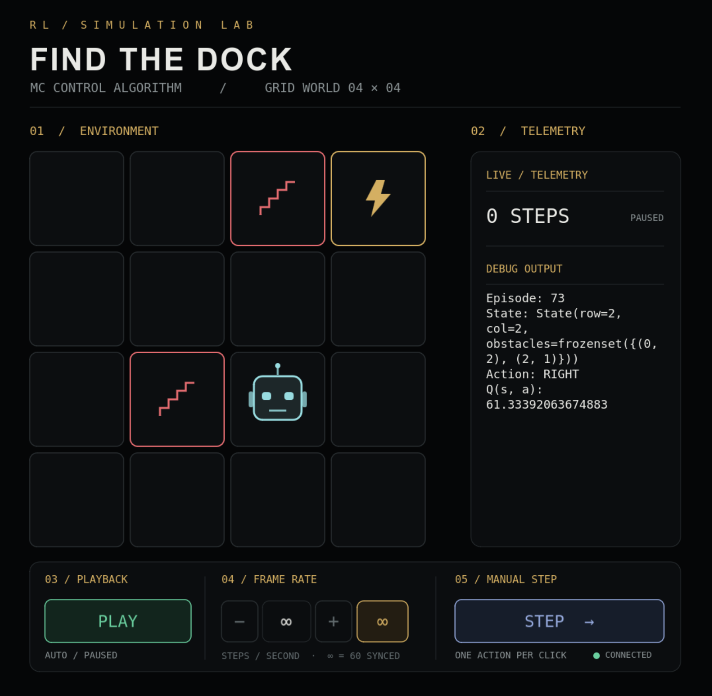

# Find the Dock

A minimal **4×4 reinforcement-learning environment** in Python, with a browser visualization powered by Phaser 3.



## Installation

Requires **Python 3.12+** and Git. Add the package to an existing PDM project:

```bash
pdm add "find_the_dock @ git+https://github.com/alien5516788/find_the_dock.git@main"
```

To run the included example from the repository:

```bash
git clone https://github.com/alien5516788/find_the_dock.git
cd find_the_dock
pdm install
pdm run example
```

## Usage

```python
from find_the_dock import State, Action, Environment

env = Environment(title="MC Control")

state = env.reset()
env.debug_print(f"Current state: {state}")

next_state, reward = env.step(Action.RIGHT)

if next_state in env.terminal_states():
    state = env.reset()
```

Set `render=False` to run without the browser visualization.

## Environment API

### Constructor

```python
Environment(
    obstacles: bool = True,
    fps: int | None = 10,
    title: str = "Markov Decision Process",
    render: bool = True,
)
```

| Parameter | Description |
| --- | --- |
| `obstacles` | When `True`, places two terminal holes on the grid. Their positions stay fixed between episodes. |
| `fps` | Target simulation steps per second when rendering. `None` selects the fast mode (60 steps/s). |
| `title` | Text displayed in the visualization header. |
| `render` | Opens the browser visualization when `True`; skips it when `False`. |

### Methods

| Method | Description |
| --- | --- |
| `reset() -> State` | Starts a new episode at a different reachable position and returns the initial state. |
| `step(action: Action \| int) -> tuple[State, float]` | Executes one action and returns the next state and reward. Raises `RuntimeError` if the episode has already ended. |
| `terminal_states() -> list[State]` | Returns the charging dock first, followed by the hole states (ordered by coordinates). |
| `debug_print(message: str) -> None` | Replaces the text shown in the visualization's debug panel. |

The current state is available as `env.state`. Other readable environment attributes include `env.start`, `env.target`, `env.steps`, `env.obstacle_positions`, `env.fps`, and `env.title`.

**`Action`** is an `IntEnum` with `UP=0`, `DOWN=1`, `LEFT=2`, and `RIGHT=3`. `Action.all()` returns the available actions.

**`State`** is immutable and hashable, with `row`, `col`, and `obstacles` attributes. `obstacles` is a `frozenset` of `(row, col)` coordinates.

### Grid and rewards

- The grid is **4×4**, with zero-based coordinates and a fixed charging dock at `(0, 3)`.
- The robot starts at a random reachable, non-terminal position. The starting position changes on each reset.
- Moving to an ordinary cell: **−1**. Attempting to move outside the grid: **−5** (the robot stays in place).
- Entering a hole: **−10**, ending the episode. Reaching the charging dock: **+100**, ending the episode.
- After reaching a terminal state, call `reset()` before taking another action.

## Visualization

The browser UI starts **paused** and provides **Play/Pause**, **Step**, and **FPS controls**. The ∞ speed option runs at a target of 60 steps/s; visual frames are capped separately. The current state and debug output are displayed alongside the grid.

Phaser is loaded from a CDN, so the browser needs internet access to load it.

## Tests

From the repository directory:

```bash
pdm run test
```
